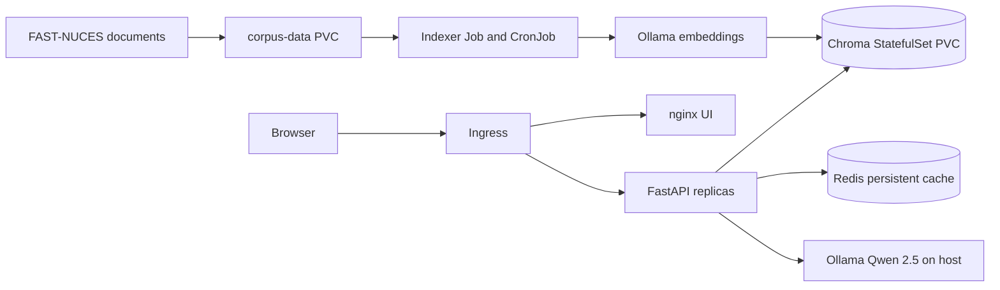

# RAHBAR — grounded university-policy RAG on Kubernetes

[](https://github.com/izumi622/SCD_ASSIGNMENT_2_RAHBAR/actions/workflows/ci.yml)

RAHBAR is a question-answering service for the publicly available FAST-NUCES corpus. The Python **indexer** extracts/OCRs official PDF documents and HTML pages, chunks the text by document structure, embeds it with a pinned model, and writes versioned evidence to ChromaDB. The **API** retrieves evidence, uses Ollama/Qwen2.5 to answer under a structured schema, checks citation metadata and numeric evidence, and abstains when support is missing. **Redis** caches suitable grounded responses. **nginx** serves the chat UI through Ingress.

**Observed local result, 8 November 2026:** nine university documents were indexed into **597 chunks**; the student's live `extract1` application returned a healthy `/readyz`. The final evaluation on the student's machine reported **15/15 automated answer checks, recall@3 = 1.0, recall@5 = 1.0, citation metadata validity = 1.0, abstention correctness = 1.0, and 0 errors**. This was partly a warm-cache test; the grading report should distinguish retrieved-evidence checks from an independent manual factuality assessment. Commit the **newest** `eval/results.json` and `eval/baseline.json` from your own machine (an older ZIP may contain older results).

## Architecture



```text
Official PDFs / HTML -> corpus/fetch.py -> corpus-data PVC
                                            |
                              standalone Indexer Job / CronJob
                                            |
                           Extract -> OCR -> clean -> structure-aware chunks
                                            |
                        pinned Ollama nomic-embed-text -> Chroma StatefulSet
                                                               |
Browser -> nginx UI -> Ingress -> FastAPI (3 replicas / HPA) ------+
                                         |       |               |
                                         |       +-> Redis cache |
                                         +-> Windows-host Ollama qwen2.5:7b
```

**Key invariant:** the API never indexes on startup. Chroma is a StatefulSet with one persistent writer. `/healthz` proves the API process is alive; `/readyz` checks Chroma availability, nonempty data, embedding-model metadata and Redis. This separation makes restarts and re-indexing safe.

## Windows CMD — clean clone / first installation

Prerequisites: Windows 10, Docker Desktop (Linux containers), Minikube with Docker driver and Calico, kubectl through Minikube, Python 3.12 with dependencies, and **Ollama on the Windows host** with `nomic-embed-text` and `qwen2.5:7b` downloaded. Make Ollama reachable at `host.minikube.internal:11434` from pods; keep it off the public internet.

```cmd
minikube start --driver=docker --cni=calico --memory=6144 --cpus=4
minikube addons enable ingress
minikube addons enable metrics-server
ollama list
docker build -t rahbar-api:extract1 api
docker build -t rahbar-indexer:lowmem1 indexer
docker build -t rahbar-ui:dev ui
minikube image load rahbar-api:extract1
minikube image load rahbar-indexer:lowmem1
minikube image load rahbar-ui:dev
minikube kubectl -- apply -k k8s/overlays/dev
```

At this point the API is **expected to be unready**, because the corpus has not been indexed. This is intentional, not a broken readiness probe.

Download the nine real sources once (ensure the `httpx` and `pyyaml` packages are installed in the selected Python environment):

```cmd
"C:\msys64\ucrt64\bin\python.exe" corpus\fetch.py
"C:\msys64\ucrt64\bin\python.exe" corpus\fetch.py --verify
```

The fetcher creates `corpus/raw/` and `_index.json`. With a standalone kubectl configured for the same context, `minikube kubectl -- apply -k` is equivalent to `kubectl apply -k`. The exact apply order is: (1) Kubernetes base resources and PVCs, (2) corpus fetch/verification, (3) upload the corpus to the PVC, (4) **real indexing Job**, (5) readiness/evaluation. Upload the *contents* of that folder to the persistent `corpus-data` PVC, mounted into `corpus-loader`:

```cmd
minikube kubectl -- get pod corpus-loader -n rahbar
minikube kubectl -- cp corpus/raw/. rahbar/corpus-loader:/corpus
minikube kubectl -- exec -n rahbar corpus-loader -- ls -l /corpus
```

**Only now** start the real, one-shot indexer. The Job is deliberately **not** in the automatic Kustomize application: blindly starting it against an empty PVC would fail. It runs the **real** pipeline (`args: []`, never `--dummy`) using the same Docker image and corpus mount as the CronJob.

```cmd
minikube kubectl -- apply -f k8s/base/indexer-job.yaml -n rahbar
minikube kubectl -- wait --for=condition=complete job/indexer-initial -n rahbar --timeout=900s
minikube kubectl -- logs job/indexer-initial -n rahbar
minikube kubectl -- port-forward -n rahbar service/api 8000:8000
```

Keep the port-forward command running in its **own** CMD window. In a different CMD:

```cmd
curl.exe --max-time 20 http://127.0.0.1:8000/readyz
"C:\msys64\ucrt64\bin\python.exe" eval\run_eval.py --api http://127.0.0.1:8000 --golden eval\golden.yaml --require-mix --out eval\results.json
"C:\msys64\ucrt64\bin\python.exe" eval\audit_saved_results.py eval\results.json
```

Re-index the real documents *without an API redeploy* (use a new Job name each time):

```cmd
minikube kubectl -- create job --from=cronjob/reindex manual-reindex-1 -n rahbar
```

**For an already working installation** (the student's current Minikube cluster), do **not** delete PVCs, reinstall the cluster, or run indexing again just to apply documentation or GitHub Actions files. The clean-clone procedure above is for a fresh environment.

## API and security checks

| Method | Path | Purpose |
| --- | --- | --- |
| GET | `/healthz` | Process liveness, no dependency checks |
| GET | `/readyz` | Chroma, nonempty collection, embedding pin, Redis readiness |
| POST | `/api/ask` | A 3–500-character question, grounded answer and retrieved citations |
| GET | `/metrics` | Prometheus request, latency, cache and fallback signals |

The latest numerical-fallback tests verify that a split official rule (e.g., the **two-semester freeze** on 2026 PDF page 22) can be reconstructed only from genuinely retrieved same-page text. The provider's output and citations are independently checked. Old policies are tagged `superseded`, and the retriever filters them out unless a historical version is explicitly requested.

## CI/CD and reproducibility

- `.github/workflows/ci.yml`: PR to `main` or push to `dev` — lint, API test coverage gate, indexer/evaluator tests, strict Kustomize manifests, Docker builds, Trivy checks and fixture-backed kind e2e evaluation.
- `.github/workflows/cd.yml`: push to protected `main` — tests, Docker Hub images tagged with the **full Git commit SHA**, ephemeral kind deployment and a smoke test through the **Ingress**.
- `eval/fixtures/`: small fictional documents used **only in CI**; a deterministic fixture-only HTTP embedding service is provided because GitHub runners cannot access the student's Windows-host Ollama. Its numbers do **not** replace real-corpus evaluation.
- `docs/CI-CD.md`: GitHub variable/secret names, branch protection, and link/evidence checklist.
- `corpus/MANIFEST.md`: real public document URLs and SHA256 checksums. PDFs/HTML themselves are not committed under `corpus/raw/`.

**No credentials or raw university documents belong in Git.** Never publish the Windows-host Ollama port to the internet. A green CI/CD run, Docker Hub tags, protected `main`, PR approval and evidence screenshots still require the owner to connect a GitHub remote and run the workflows; a local ZIP cannot prove them.

## Submission checklist

Before submitting, run `scripts/check_submission.py`, commit the real 15-question evaluation files, capture the GitHub CI and successful CD URLs, show SHA-tagged Docker Hub images, and confirm branch protection with one reviewer approval and a demonstrated blocked PR. Complete measured chunking/cache experiments and honest breakage analysis in `docs/` where their actual measurements are currently pending.

AI assistance is documented in `docs/AI-USAGE.md` and should be reviewed and amended by the submitting team.

## Real evidence capture

From the working Windows project, execute `scripts\capture_evidence.cmd` after updating HPA maxReplicas to 8 and while the API port-forward on 8000 is active. Inspect each created `docs/evidence/` file. Capture GitHub/PR/Docker Hub screenshots separately; the script cannot invent those external results. The optional hosted-LLM Secret manifest in `k8s/examples/` contains **only `REPLACE_ME`** and must not be applied to an Ollama-host installation.
